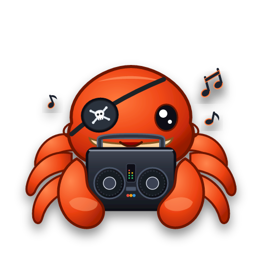

# 🦀 CaranguejoRPG — Escudo do Mestre & Bot de Áudio para Discord

<div align="center">



**O painel tudo-em-um definitivo para Mestres de RPG de Mesa (D&D 5e, Tormenta20, Ordem Paranormal, Vampiro/WoD e Call of Cthulhu).**

[](https://nodejs.org/)
[](https://react.dev/)
[](https://www.typescriptlang.org/)
[](https://discord.js.org/)
[](https://tailwindcss.com/)
[](https://neutralino.js.org/)
[](https://www.docker.com/)

[⚠️ Disclaimer](#-disclaimer-importante--projeto-vibecodado) •
[Funcionalidades](#-funcionalidades-completas) •
[Tecnologias](#-tecnologias-utilizadas) •
[Arquitetura & Métodos](#-métodos-e-funcionamento) •
[Instalação](#-tutorial-de-instalação) •
[Guia de Uso](#-guia-básico-de-uso) •
[Bot no Discord](#-comandos-do-bot-no-discord-prefixo-)

</div>

---

## ⚠️ DISCLAIMER IMPORTANTE — PROJETO VIBECODADO!

> 🚨 **ATENÇÃO / AVISO:**  
> Este aplicativo foi **100% VIBECODADO** (desenvolvido no mais puro fluxo criativo com inteligência artificial, prototipagem acelerada e muita cafeína).  
> **NÃO É RECOMENDADO PARA USO SÉRIO**, produção empresarial, infraestruturas críticas ou qualquer ambiente onde falhas de software possam causar prejuízos.  
> 
> Ele foi feito sob medida para mestres se divertirem em suas mesas de RPG de fim de semana com amigos. Se o dragão cuspir fogo e um som travar, respire fundo, role um d20 e reinicie o servidor com o script `INICIAR_CARANGUEJORPG.bat`! Divirta-se! 🎲🍻

---

## 📖 Visão Geral

O **CaranguejoRPG** nasceu para resolver a dor de cabeça de todo Mestre de RPG: alternar desesperadamente entre 15 abas do navegador, bots de música do Discord que caem do nada, pastas desorganizadas de MP3, fichas de monstros e blocos de anotações.

Ele unifica em uma única interface ultrarrápida:
1. **Transmissão de Áudio no Discord**: Trilha sonora contínua, efeitos sonoros (Soundboard) e loops de ambientação (chuva, taverna, caverna) transmitidos via Opus diretamente para o canal de voz.
2. **Escudo do Mestre Modular 2D**: Uma grade personalizável com widgets arrastáveis e redimensionáveis.
3. **Iniciativa & Combate com PV Privado**: Ordem de turnos, contador de HP (atual e máximo), distinção dinâmica entre Aliados e Inimigos, com a garantia absoluta de que a vida dos monstros e heróis nunca é vazada no Discord.
4. **Dashboard de Estatísticas em Tempo Real**: Métricas de tempo total de áudio tocado, contagem de mensagens do bot e histórico recente de rolagens com análise de dados.
5. **Rolagens de Dados com Prefixo Estrito `\`**: Suporte a sistemas gerais (d4-d100) e Mundo das Trevas (Storyteller d10) com efeitos sonoros sintéticos reais.
6. **Estúdio de Mapas, Desenho Tático & Marcadores**: Crie cenários com pontos de interesse secretos e envie imagens aos jogadores com 1 clique.
7. **Exportação da Sessão em PDF**: Salve o resumo da crônica, NPCs ativos e notas em arquivo PDF formatado para impressão ou arquivamento.

---

## ✨ Funcionalidades Completas

### 🛡️ 1. Escudo do Mestre Modular (Master Screen 2D)
* **Layout 2D Flexível:** Grade de 12 colunas com suporte a widgets de 1/3, 1/2 e 1/1 de largura, além de alturas ajustáveis (compacto, expandido e recolhido).
* **Modo de Organização (Drag & Drop):** Reordene qualquer painel arrastando pelo cabeçalho.
* **Presets Prontos:** Modos "Equilibrado", "Combate Focado", "Narrativo/Roleplay" e "Áudio & Imersão".
* **Multi-Timers & Cronômetros:** Controle de tochas (1 hora), magias com concentração (1 minuto), descanso curto e duração da sessão.
* **Bloco de Notas Multi-Abas & Rascunho (Post-it):** Abas para pistas, segredos, recompensas e notas rápidas com persistência local automática.
* **Clima, Horário & Atmosfera:** Controle de dia da campanha, ciclo solar (Madrugada a Noite) e clima com ícones dinâmicos.

---

### ⚔️ 2. Rastreador de Iniciativa & Combate (Com PV Privado e Facções)
* **Controle Completo de HP:**
  * Contador interativo de HP atual e HP máximo.
  * Botões rápidos de ajuste: `-5`, `-1`, `+1`, `+5` e inputs numéricos diretos.
  * Barra de vida colorida por estado: Saudável (>50% verde), Ferido (20-50% amarelo), Crítico (<20% vermelho) e Derrotado/Inconsciente (0 HP com caveira 💀).
* **Autopreenchimento Inteligente de NPCs:**
  * Dropdown para puxar combatente diretamente de um NPC já cadastrado na crônica.
  * Ao digitar o nome ou selecionar um NPC, o CaranguejoRPG puxa automaticamente os Pontos de Vida (HP e Max HP) cadastrados na ficha.
* **🔒 Privacidade Absoluta do Mestre:**
  * **O HP NUNCA é transmitido ao Discord.** As notificações de turno enviadas ao canal público informam única e exclusivamente o nome do personagem, valor de iniciativa e a rodada atual.
* **Mostrador com Filtro de Aliados e Inimigos:**
  * Abas de visualização rápida: `[ Todos ]`, `[ 🛡️ Aliados ]` e `[ ⚔️ Inimigos ]`.
  * Barra de Balanço de Batalha (Power Balance): visualizador visual comparando a vida total de Aliados contra Inimigos.
  * Botão de 1-clique em cada card para alternar facção entre Aliado e Inimigo no mesmo widget.

---

### ⚡ 3. Dashboard de Estatísticas de Uso em Tempo Real
* **Tempo de Áudio Reproduzido:**
  * Exibição do tempo total acumulado e do tempo da sessão atual em formato legível (`01h 24m 30s`).
  * Ticker local em tempo real para atualização fluida a cada segundo quando músicas ou ambientes estiverem tocando.
* **Contador de Mensagens do Bot:**
  * Total de mensagens enviadas para o Discord.
  * Discriminação por categoria: Narrações épicas, Anúncios de Iniciativa, Rolagens de Dados, Fichas de NPCs, Mapas e Chat interativo.
* **Histórico Recente de Rolagens de Dados:**
  * Lista ao vivo das últimas rolagens feitas na mesa e no Discord.
  * Badges visuais de resultado: *Crítico!*, *Sucesso Excepcional*, *Falha Crítica* e *Falha*.
  * Mini-indicadores: Total de rolagens, taxa de sucesso percentual, contagem de acertos/falhas críticas e média geral dos dados.

---

### 🎲 4. Rolador de Dados & Comandos no Discord (Prefixo `\`)
* **Prefixo Estrito `\` no Discord:**
  * O bot aceita exclusivamente o prefixo contra-barra `\` para evitar conflito com outros bots (como Avrae ou Tupperbox).
  * `\r [dados] [motivo]` — **Storyteller / World of Darkness (WoD d10)**:
    * Rola d10s, threshold 7+, explosão nos 10s e cancelamento por 1s. Exemplo: `\r 7 Furtividade`.
  * `\d [fórmula] [motivo]` — **Multi-Dados Gerais (D&D / d20)**:
    * Suporta operadores matemáticos e keep highest/lowest: `\d 1d20+7 Ataque`, `\d 2d20kh1+5 Vantagem`, `\d 8d6 Bola de Fogo`.
  * `\help` — Exibe guia visual interativo de comandos.
* **Efeitos Sonoros Reais de Dados:**
  * Integração com Web Audio API gerando som sintético de rolagem de dados e impacto, ou disparando amostras do Soundboard.

---

### 🎵 5. Player de Áudio, Ambiente & Soundboard
* **Player Principal de Músicas:**
  * Scrubber interativo (barra de progresso arrastável).
  * Fila de reprodução (Queue), modo repetição (Faixa, Pasta, Aleatório).
  * Suporte a faixas locais (`.mp3`, `.ogg`, `.wav`) organizadas por pastas.
* **Player de Som Ambiente (Loop):**
  * Canal paralelo de reprodução contínua (chuva, taverna, caverna) com volume dedicado no mixer para não atrapalhar a fala dos jogadores.
* **Soundboard com 1-Clique:**
  * Disparo de efeitos curtos (SFX): passos, espadas, rugidos de monstros, portas rangendo, trovões.

---

### 🗺️ 6. Gerenciador de Cenários & Mapas Interativos
* **Upload e Visualização de Mapas:**
  * Mapas táticos e ilustrações de cidades ou masmorras.
* **Marcadores Interativos (POIs):**
  * Posicione ícones em coordenadas específicas com nome, descrição pública e **Segredos Privados do Mestre**.
* **Transmissão Direta ao Discord:**
  * Envie o mapa e seus marcadores para o chat dos jogadores em 1 clique.

---

### 🎨 7. Estúdio de Desenho & Tática (Paint Studio)
* **Sistema de Camadas (Layers):** Camadas independentes para mapa, tokens, anotações e grid.
* **Controles de Imagem:** Arraste imagens para o canvas, redimensione, gire, aplique filtros de RPG (*Pergaminho Antigo*, *Grimdark*, *Fantasma*) e fixe no mapa.
* **Preservação de Estado:** Mude de tela à vontade; o desenho continua de onde você parou.

---

### 📄 8. Exportação da Sessão em PDF
* Modal de exportação com geração client-side via **jsPDF**.
* Relatório elegante contendo título da sessão, data, duração total, NPCs cadastrados e notas do mestre formatadas.

---

## 🛠️ Tecnologias Utilizadas

| Camada | Tecnologias |
| :--- | :--- |
| **Frontend** | React 19, TypeScript 5.8, Tailwind CSS v4, Vite, Lucide React |
| **Backend & Servidor** | Node.js 20+, Express, TypeScript (`tsx`) |
| **Integração Discord** | Discord.js v14, `@discordjs/voice`, `prism-media` |
| **Processamento de Áudio** | Web Audio API (Sons de Dados), FFmpeg (`fluent-ffmpeg` / `ffmpeg-static`) |
| **Geração de Documentos** | jsPDF (Exportação de crônica do mestre) |
| **Persistência de Dados** | Banco de dados local baseado em JSON assíncrono thread-safe (`data/db.json`) |
| **Desktop Standalone** | Neutralino.js (Executável nativo leve de ~5MB sem Chromium pesado) |
| **Containerização** | Docker, Docker Compose |

---

## ⚙️ Métodos e Funcionamento

### 1. Comunicação Web UI ↔ Discord Bot
O servidor Express expõe rotas REST protegidas localmente (`/api/bot/*`, `/api/audio/*`, `/api/stats/*`, `/api/dice/*`):
* Quando o Mestre clica para anunciar um turno de combate, a UI chama `POST /api/bot/announce-turn` passando apenas nome, iniciativa e rodada. O backend monta um Embed colorido no Discord sem nenhum dado de HP.
* Quando o áudio é reproduzido no navegador, um heartbeat periódico (`POST /api/stats/audio-heartbeat`) mantém as estatísticas de tempo de reprodução sincronizadas no backend.
* O bot escuta mensagens do Discord e filtra comandos que começam estritamente com `\`, executando o motor de dados do servidor e transmitindo a resposta em formato Embed elegante.

### 2. Motor de Áudio para Canais de Voz
* O backend utiliza `@discordjs/voice` com `AudioPlayer` e buffers configurados para evitar gagueiras em conexões instáveis.
* Arquivos locais de áudio passam por decodificação FFmpeg e são transmitidos via Opus diretamente para o canal de voz ativo.

### 3. Persistência de Dados
* Todos os dados (NPCs, pastas, histórico de dados, presets, configurações e estatísticas) ficam salvos na pasta `/data` em formato JSON legível.
* Não há necessidade de configurar banco de dados externo (Postgres, Mongo ou Firebase); basta copiar a pasta `/data` para fazer backup de toda a sua crônica.

---

## 🚀 Tutorial de Instalação

### Pré-requisitos
* **Node.js** versão 20.x ou superior ([Download Node.js](https://nodejs.org/))
* Um bot criado no [Discord Developer Portal](https://discord.com/developers/applications)

---

### Passo 1: Obter o Código
```bash
git clone https://github.com/seu-usuario/caranguejorpg.git
cd caranguejorpg
```

### Passo 2: Instalar as Dependências
```bash
npm install
```

### Passo 3: Criar e Configurar o Bot do Discord
1. Acesse o [Discord Developer Portal](https://discord.com/developers/applications) e clique em **"New Application"**.
2. Vá na aba **Bot** e clique em **"Reset Token"** para obter o seu token.
3. Ative as **Privileged Gateway Intents** (obrigatórias para ler mensagens de dados):
   * ✅ **MESSAGE CONTENT INTENT**
   * ✅ **SERVER MEMBERS INTENT**
   * ✅ **PRESENCE INTENT**
4. Vá na aba **OAuth2** (ou Installation), selecione os escopos `bot` e marque as permissões:
   * Conectar (Connect)
   * Falar (Speak)
   * Enviar Mensagens (Send Messages)
   * Anexar Arquivos (Attach Files)
   * Incorporar Links (Embed Links)
5. Adicione o bot ao seu servidor do Discord com o link gerado.

### Passo 4: Configurar o Arquivo `.env`
Copie o modelo de variáveis de ambiente:
```bash
cp .env.example .env
```
Abra o `.env` e preencha:
```env
PORT=3000
DISCORD_BOT_TOKEN=seu_token_aqui
DISCORD_CLIENT_ID=seu_client_id_aqui
DISCORD_GUILD_ID=id_do_seu_servidor
DISCORD_VOICE_CHANNEL_ID=id_do_canal_de_voz
DISCORD_TEXT_CHANNEL_ID=id_do_canal_de_texto
```
*(Nota: Você também pode preencher ou trocar esses dados a qualquer momento diretamente pela interface gráfica no menu de Configurações do CaranguejoRPG!)*

### Passo 5: Iniciar a Aplicação

#### No Windows:
Basta dar dois cliques no arquivo:
```cmd
INICIAR_CARANGUEJORPG.bat
```

#### No Linux / macOS:
```bash
npm run dev
```

Abra o seu navegador em: **`http://localhost:3000`**

---

### 🐳 Execução via Docker
Caso queira rodar o CaranguejoRPG em um mini-servidor ou Raspberry Pi:
```bash
docker compose up -d
```
O aplicativo subirá na porta `3000` e manterá os dados montados no volume `./data`.

---

### 📦 Gerar Executável Portátil (.EXE de ~5MB via Neutralino.js)
Para empacotar o aplicativo como um programa de desktop portátil:
```cmd
gerar-executavel.bat
```
O executável compilado será colocado na pasta `dist-portable/`.

---

## 🎮 Guia Básico de Uso

### 1. Conectando o Bot ao Canal de Voz
1. Abra a aplicação no navegador (`http://localhost:3000`).
2. Clique no ícone do Discord no canto superior direito para abrir o painel de diagnósticos.
3. Se o Token estiver configurado, selecione seu canal de voz e clique em **"Conectar ao Canal de Voz"**.
4. O bot entrará na chamada de voz do Discord e ficará pronto para tocar trilhas e efeitos.

### 2. Controlando o Combate com PV Privado
1. No menu superior, vá para a tela **"Mestre / Escudo"**.
2. No widget **"Iniciativa & Combate"**:
   * Use o seletor para puxar um NPC já cadastrado (o HP atual e máximo serão preenchidos automaticamente).
   * Ou digite o nome de um jogador/monstro, valor de iniciativa, PV e selecione se é **Aliado** ou **Inimigo**.
   * Clique em **+ Adicionar**.
3. Alterne entre as abas de facção (`Todos`, `Aliados`, `Inimigos`) e acompanhe a barra de equilíbrio de vida da batalha.
4. Ajuste os PVs com os botões rápidos `-5`, `-1`, `+1`, `+5` ou edite os campos numéricos.
5. Clique em **"Próximo Turno"** ou **"Anunciar Turno"**: o bot mandará um aviso no Discord sem jamais expor o HP do combatente.

### 3. Acompanhando o Dashboard em Tempo Real
1. No Escudo do Mestre, visualize o widget **"Dashboard de Estatísticas & Monitor de Uso"** (ou na aba de estatísticas).
2. Acompanhe os contadores ao vivo de tempo total de música tocada, mensagens enviadas pelo bot e o feed das últimas rolagens de dados com percentuais de sucesso.

---

## 🎲 Comandos do Bot no Discord (Prefixo `\`)

| Comando | Descrição | Exemplo |
| :--- | :--- | :--- |
| `\r [dados] [motivo]` | Rolagem WoD Storyteller d10 (Dificuldade 7+, 10s explodem, 1s cancelam) | `\r 7 Percepção + Prontidão` |
| `\d [fórmula] [motivo]` | Rolagem Multi-Dados Geral (d4 a d100, soma, modificadores e vantagens) | `\d 2d20kh1+5 Ataque com Vantagem` |
| `\d 8d6 [motivo]` | Rolagem de dano com múltiplos dados poliédricos | `\d 8d6 Bola de Fogo` |
| `\help` | Exibe o menu interativo de ajuda com sintaxe e exemplos | `\help` |

---

## 📂 Estrutura de Pastas

```text
caranguejorpg/
├── 📁 data/                      # Arquivos locais persistentes da sua mesa
│   ├── 📁 music/                 # Músicas organizadas em pastas (.mp3, .ogg)
│   ├── 📁 ambience/              # Sons de ambiente contínuos (.mp3, .ogg)
│   ├── 📁 sfx/                   # Efeitos sonoros rápidos do soundboard
│   ├── 📁 npcs/                  # Imagens e avatares de NPCs
│   ├── 📁 saves/                 # Backups em JSON das sessões
│   └── 📄 db.json                # Banco de dados local
├── 📁 server/                    # Servidor Node.js + Express + Discord Bot
│   ├── 📄 server.ts              # Ponto de entrada do servidor full-stack
│   ├── 📄 routes.ts              # Endpoints da API REST
│   ├── 📄 discordBot.ts          # Serviço do bot do Discord, áudio e dados
│   ├── 📄 soundManager.ts        # Gerenciador de fila e arquivos de som
│   └── 📄 db.ts                  # Adaptador de persistência JSON
├── 📁 src/                       # Frontend React 19 + TypeScript + Vite
│   ├── 📁 components/            # Widgets do Escudo, Leitor, Paint e Modais
│   │   ├── 📄 MasterScreen.tsx           # Escudo do Mestre com Iniciativa e Grade
│   │   ├── 📄 RealtimeDashboardWidget.tsx # Dashboard de estatísticas em tempo real
│   │   ├── 📄 SummaryStatsWidget.tsx     # Resumo e catalogo da mesa
│   │   └── ...
│   ├── 📁 context/               # AudioContext centralizado
│   ├── 📁 types.ts               # Tipagens TypeScript completas
│   └── 📁 utils/                 # Player sintético de som de dados (Web Audio)
├── 📄 INICIAR_CARANGUEJORPG.bat  # Script de inicialização automática no Windows
├── 📄 neutralino.config.json     # Configuração do executável nativo
├── 📄 docker-compose.yml         # Configuração de containers Docker
└── 📄 package.json               # Dependências do projeto
```

---

## 🤝 Licença & Contribuição

Este projeto é disponibilizado sob a licença **MIT**. Você é livre para usá-lo em suas mesas de RPG, customizar o código, criar novos widgets e sugerir melhorias!

<div align="center">

**Que seus d20s rolem sempre em 20 natural! 🦀🎲⚔️**

</div>
